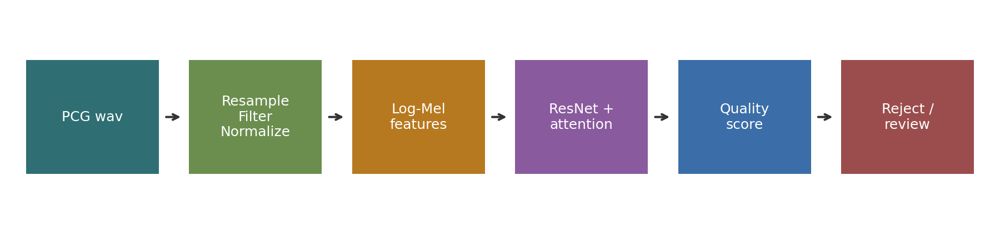
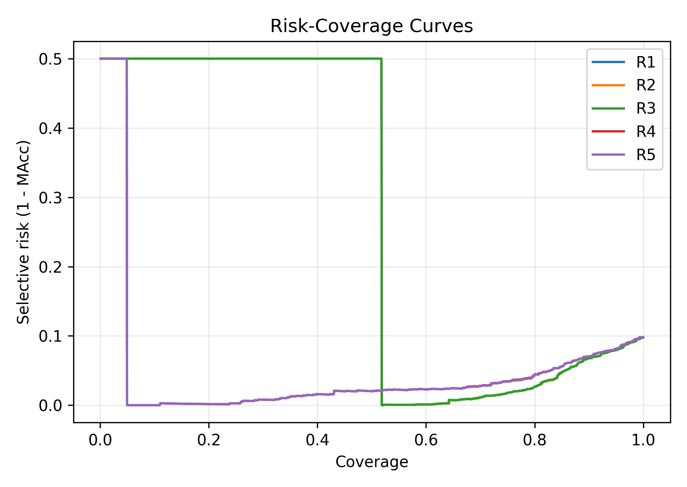
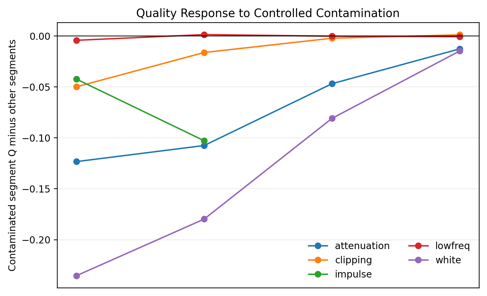

# Quality-aware Selective Prediction for Phonocardiogram Screening

This repository provides a compact, review-ready implementation of a
quality-aware selective prediction pipeline for phonocardiogram (PCG) screening.
It includes signal preprocessing, Log-Mel feature extraction, a ResNet-attention
model definition, confidence-based rejection, signal-quality scoring, and a
single-record command-line demo.

The repository is intended to share the core implementation logic without
including raw medical recordings, trained checkpoints, or manuscript files. A
synthetic PCG-like waveform is included only to verify that the demo runs.

## Pipeline

PCG wav -> resample/filter/normalize -> fixed-length segment -> Log-Mel
spectrogram -> ResNet + attention or demo backend -> class probabilities ->
quality score -> selective decision -> review or reacquisition suggestion.



## Main Components

- PCG preprocessing with resampling, band-pass filtering, normalization, and
  fixed-length cropping or padding.
- Log-Mel spectrogram generation with a lightweight NumPy/SciPy implementation.
- PyTorch model definition for a ResNet-style PCG classifier with temporal
  attention pooling.
- Confidence-based rejection for low-confidence recordings.
- Rule-based signal-quality descriptors for low-frequency interference,
  high-frequency noise, clipping, spectral flatness, and amplitude issues.
- A deterministic no-checkpoint demo backend for reproducible local testing.

## Repository Layout

```text
pcg-quality-aware-selective-screening/
|-- README.md
|-- DATASET.md
|-- LICENSE
|-- requirements.txt
|-- configs/
|   `-- default.yaml
|-- data_preprocess/
|   |-- preprocess.py
|   `-- feature_logmel.py
|-- models/
|   |-- resnet_attention.py
|   `-- predict.py
|-- quality/
|   |-- quality_metrics.py
|   `-- rejection.py
|-- demo/
|   |-- app.py
|   `-- demo_predict.py
|-- examples/
|   `-- synthetic_pcg.wav
|-- figures/
|   |-- pipeline.png
|   |-- logmel_example.png
|   |-- risk_coverage_curve.png
|   `-- noise_robustness.png
|-- scripts/
|   `-- create_demo_assets.py
`-- docs/
    `-- project_summary.md
```

## Quick Start

```bash
pip install -r requirements.txt
python demo/demo_predict.py --input examples/synthetic_pcg.wav --save-logmel outputs/input_logmel.png
```

Expected output fields:

```text
Normal probability
Abnormal probability
Prediction
Confidence
Rejected
Quality score
Major quality issues
Recommendation
```

The generated `outputs/input_logmel.png` file is a runtime artifact and is
ignored by version control.

## Using a Trained Checkpoint

The repository does not include trained weights. To run with a local PyTorch
checkpoint:

```bash
python demo/demo_predict.py --input path/to/record.wav --weights checkpoints/model.pt
```

Checkpoint files are intentionally excluded from version control by `.gitignore`.

## Experimental Snapshot

Local experiments were performed on the PhysioNet/CinC 2016 heart sound
recordings with recording-level stratified folds. The table below is included
as a compact reference for the reported workflow.

| Method | MAcc | AUC | Reject rate |
| --- | ---: | ---: | ---: |
| Baseline ResNet | 0.9034 | 0.9663 | 0.0000 |
| ResNet + confidence rejection | 0.9145 | 0.9757 | 0.0833 |

Selective prediction improves retained-sample performance by routing uncertain
recordings to review rather than forcing every recording into a binary label.




## Data and Safety Notice

- This repository is for research-code review and reproducibility support.
- It is not a medical device and must not be used for clinical diagnosis.
- Original PCG recordings are not included. See `DATASET.md` for dataset access
  and local organization instructions.
- Large checkpoints, raw recordings, local experiment logs, and manuscript files
  should remain outside the public repository.
